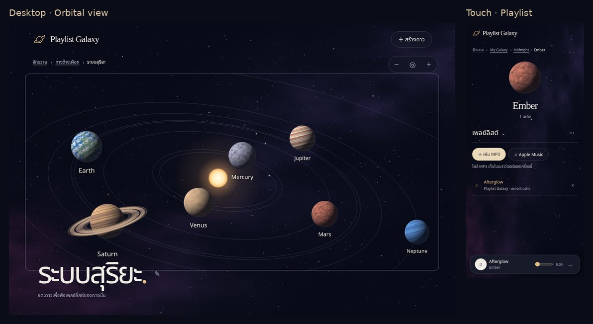

# Camera and playlist review

Drag anywhere on the map to orbit. Scroll or pinch to zoom. Tap My Galaxy → Midnight → Ember, return to Midnight and tap Tide, then return to Ember. The second visit resumes Afterglow at its saved position. Tap the playlist heading to give the planet more space. The path above the planet and Escape both work during a flight.



## Browser checks

The camera projects original sprites, orbit guides and a seeded star field with Canvas 2D. No WebGL context is needed. Opening a shared planet link stays silent. Audio starts on the listener's selection and keeps its own clock independently of the visual transition.

The test run used Chromium Headless Shell 156.0.8078.79 on Linux. It covered mouse, trusted touch including pinch, keyboard, reduced motion, direct links, browser history, imported MP3s, the original demo recordings and a populated version-one IndexedDB fixture. In separate MP3 and demo runs, all four trusted A/B selections landed during an active camera flight. Only the selected track played. The external Apple song link and the optional MusicKit integration were checked with an unconfigured endpoint and a test double. The Saturn receiver checks covered standby, mute and downloaded airchecks.

```sh
node --test checks/*.test.cjs
python3 checks/galaxy.py
python3 checks/camera.py
python3 checks/navigation.py
python3 checks/journeys.py
python3 checks/wheel_travel.py
python3 checks/thumb_navigation.py
python3 checks/receiver.py
python3 checks/map_latency.py --runs 5
```

The Python checks use Playwright. The audio checks also use FFmpeg. Pass `--chromium /path/to/chromium` to use an installed Chromium executable.

## Flying with one thumb

Tap a destination for the automatic flight. For manual travel, tap **คุมการบิน**, tap the destination and use the range beside its name. Lifting partway holds that frame. Even at 100% you can retract while holding the slider. Releasing at the end enters the destination, adds a history entry and starts or resumes its playlist. **ยกเลิก** restores the departure view. You can pause the current track while the flight is held. With reduced motion, tap to enter directly.

The bottom **กลับ** button names the parent. On the 320 × 568 starting revision `bacec08`, the entire map hint (y = 509–527 CSS px) fell behind the playing track. The updated hint ends at 447 px, the navigation row begins at 456 px and the player at 504 px. At 390 × 844 the corresponding edges are 723, 732 and 780 px. The original detail Back button was near y = 90 px; the additional bottom controls are 44 px tall.

Use `python3 checks/thumb_navigation.py --chromium /path/to/chromium --evidence /tmp/thumb` to repeat the checks and save screenshots. The check uses trusted Chromium touch input, verifying a stationary 55% approach, reversal, parent navigation, browser Back with a finger still down, a second-finger interruption, native range keyboard control, a paginated map and dialogs. It follows Ember → Tide → Ember with imported MP3s at 320 × 568 and demo audio at 390 × 844. These are touch-emulated Linux browser viewports. Physical iOS and Android devices were not tested.

## Steering a flight with the wheel

From Midnight, point at Ember and scroll up. Ongoing wheel input moves from the anchored map into the same flight used by a click. Small trackpad deltas seek directly. A coarse wheel tick glides to its requested point in at most 85 ms. Stop halfway, scroll back to retrace the route, or click to finish. Escape cancels and restores the original map view. Scrolling away to zero leaves the map at the departure scale so you can keep zooming out. After landing, Back returns to the view where you first pointed at the planet.

Until arrival, the current playlist owns the player and the URL stays at the departure point. The map adds a single history entry at landing and absorbs the remainder of that wheel gesture. Reduced motion enters immediately once the selected body is close enough. The ordinary map zoom, two-finger pinch and keyboard controls are still available.

The wheel check held a flight at 30% for 900 ms, then returned to the same frame by reversing the wheel. It also tests fine deltas, switching from the wheel to a drag or a click, the player controls mid-flight, container and moon travel, Escape, browser history and reduced motion. In a continuous 40-event gesture, Midnight opened once. The wheel was still pointing at a reachable child planet, and that next map kept its original scale. The demo and two imported MP3s each follow Ember → Tide → Ember with a single active decoder and the saved playback position.

On a fresh Chromium document we used read-only CDP observations with user gestures disabled. Actual wheel input reached Ember without giving the page audio activation. The Play button then started Afterglow on one click. The check runs with the browser's gesture-required autoplay policy. [Chrome autoplay policy](https://developer.chrome.com/blog/autoplay/)

## Keeping a planet under the pointer

The camera picks the planet's projected depth for a wheel zoom or a two-finger gesture. On empty orbit space it intersects the orbital plane. Tab to a planet to zoom around it with +/−. The original map buttons still zoom around the center.

The table measures the final distance in CSS pixels from the planet's center to the intended screen point. For the pinch, the two fingers spread as their midpoint moves 48 px right and 30 px up. Use `checks/navigation.py` with the same Chromium binary to repeat the checks. The desktop viewport was 1160 × 760, and the touch viewport was 390 × 844.

| Input | Starting checkpoint `c6a2558` | Anchored zoom |
| --- | ---: | ---: |
| Three wheel events over Neptune | 208.61 px | 1.20 px |
| Pinch and pan together over Saturn | 22.24 px | 0.27 px |
| Four + keystrokes with Tide focused | 341.99 px | 0.86 px |

The check also samples each displayed frame during desktop zoom and the reverse trip, and repeats the moving pinch with reduced motion.

## Leaving a map during a gesture

On the zoom checkpoint `dff5572`, holding two fingers on Midnight while pressing Escape could carry the gesture into My Galaxy. The incoming map moved despite receiving no new press. Each map now releases its active input when the displayed bodies change.

The navigation check starts a gesture during a return flight while Ember is playing. It goes up again with both fingers or the mouse button still held, moves them over the parent map, then releases. In both cases My Galaxy settled at its saved position (0.00 px displacement). The check samples the active audio element each frame, switches to Tide with a fresh press and returns to Ember at its saved time. The touch case uses the demo, and the desktop case imports a real MP3 and uses browser Back.

## Travelling between scales

Follow Milky Way → Solar System → Saturn → Titan, or My Galaxy → Midnight → Ember, then return to Midnight for Tide. The departure sky briefly retains its neighbouring worlds and orbit lines. As the camera enters the new map those landmarks pass at a different rate from the destination. Returning from a portrait moves the actual planet button back to its saved map position.

At `0519869`, the flying image of Saturn and its selectable counterpart followed separate paths on the return to the Solar System. Their centers separated by up to 37.25 CSS px on desktop and 96.04 px on touch in the recorded runs. They now coincide throughout that return. The journey test also taps another body during an active flight and counts map paints after settling.

The moon close-up uses its own surface from departure. On the same starting revision, the visible image left Saturn's portrait, 332.91 px from the Titan marker on desktop and 221.58 px on touch. The old return ended at that same distance from the marker. In the new runs both ends measured within 0.01 px on both viewports. The test compares the flying texture to the real Titan portrait, reverses the flight twice before landing, scrolls a playlist and enables reduced motion during a return. It also verifies that the settled map did not draw another frame during a 300 ms sample.

Folding Neptune's playlist exposes a larger portrait. On the moon-flight checkpoint `788bb2f`, returning from that view cut its width from 640 to 472 CSS px on a 1440 × 950 desktop, and from 335.39 to 327.56 px on a 390 × 844 touch viewport. The first frame now preserves the displayed width on both. The check records both the first frame and the visible width at the trusted wheel or second-finger event. In an offline run, Neptune was 580.42 px wide when the wheel arrived and held at 580.42 px. On the touch viewport it was 335.33 px at contact and held at 335.33 px. Zoom-out then responded in both cases.

Run `python3 checks/journeys.py --chromium /path/to/chromium --evidence /tmp/journeys` to save mid-flight frames and per-frame coordinates. The `--measure-only` option can also be used with a copy of this check on the starting revision.

On the final flight pass, seven alternating cold visits per build and viewport measured the time from clicking the Solar System to the second animation-frame callback. The medians were 116.2 → 118.2 ms on desktop and 114.8 → 109.9 ms on touch (starting revision → updated flight). Copying the departure sky took a median 1.3 ms on desktop and 0.8 ms on touch. The click-handler ranges overlapped. Use `checks/map_latency.py` on both checkouts to repeat the endpoint measurements.

## Cold entry into the Solar System

Starting in the Milky Way, each sample clicks the Solar System in a fresh browser context. The handler column measures synchronous processing of that click. The frame column ends at the second animation-frame callback following it. Values are medians of five runs with the same machine and browser. Mobile is a 390 × 844 touch viewport at 2× pixel density. The desktop viewport is 1160 × 760 at 1×.

| Viewport | Handler before | Handler after | Two frames before | Two frames after |
| --- | ---: | ---: | ---: | ---: |
| Desktop | 297.6 ms | 117.2 ms | 369.1 ms | 164.1 ms |
| Mobile emulation | 260.0 ms | 93.0 ms | 302.7 ms | 114.4 ms |

The before measurements used `fbc1f19035cdcad5a74f8235cd3d94a7e9ae47ea`. The after measurements used the tree published as `ed005f79d8f0ba6397933fe9762d65254d9eae8e`. Run the same timing script with each checkout for a local comparison. Real-device Safari and Android GPU timing remain unmeasured.

## Reference

The supplied Coma link reached CosmoLapse's startup error in Cloud Chrome with WebGL disabled. Chromium with software WebGL2 successfully created a context, but the Coma page returned HTTP 403 in both viewport sizes. The live camera's easing, gesture sensitivity and point density could not be measured. The published guide describes clicking a body to fly to it and navigating across astronomical scales. Playlist Galaxy uses its own timings, projected layout, surfaces and catalog. [CosmoLapse FAQ](https://cosmolapse.com/faq) · [CosmoLapse overview](https://cosmolapse.com/about)
